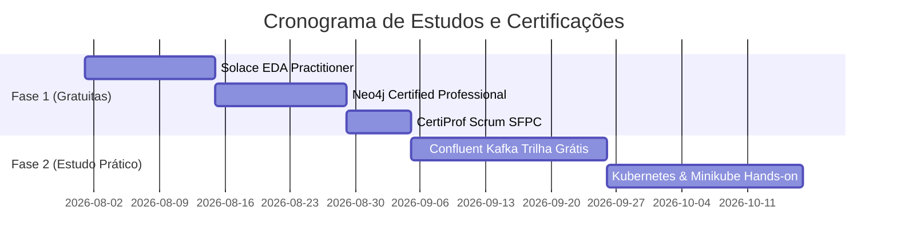

# Plano de Estudos: Certificações Profissionais (Backend & Arquitetura)

Este documento estabelece o plano de estudos e mapeamento de certificações estratégicas para **Taui Silva Lima**, com foco em **Desenvolvimento Backend (Java / C#), Arquitetura de Microsserviços, Mensageria Distribuída (Kafka / EDA), Bancos de Dados e Cloud/DevOps**.

---

## 🔍 Diagnóstico das Certificações Selecionadas

| Certificação | Custo | Status de Prioridade | Relevância no Mercado |
| :--- | :---: | :---: | :--- |
| **Solace Certified EDA Practitioner** | **Gratuito ($0)** | 🚀 **Prioridade 1** (Iniciar Imediatamente) | **Alta**: Valida Arquitetura Orientada a Eventos (EDA) e Mensageria. |
| **Neo4j Certified Professional** | **Gratuito ($0)** | 🚀 **Prioridade 2** (Foco em NoSQL) | **Alta**: Banco de dados de Grafos respeitado internacionalmente. |
| **CertiProf Scrum Foundation (SFPC)** | **Gratuito ($0)** | 🚀 **Prioridade 3** (Metodologia Ágil) | **Média/Alta**: Validação oficial de conceitos Scrum. |
| **Confluent Certified Developer for Apache Kafka (CCDAK)** | Pago ($155 USD) | ⏳ Estudo Grátis / Exame Futuro | **Muito Alta**: Padrão ouro em mensageria com Apache Kafka. |
| **Oracle Certified Professional (OCP) Java** | Pago ($245 USD) | ⏳ Estudo Grátis / Exame Futuro | **Muito Alta**: Certificação de referência no ecossistema Java. |
| **Certified Kubernetes Application Developer (CKAD)** | Pago ($395 USD) | ⏳ Estudo Grátis / Exame Futuro | **Muito Alta**: Essencial para microsserviços em containers. |
| **Red Hat Certified Specialist in Kafka (EX267)** | Pago ($400+ USD) | ⏳ Longo Prazo | **Alta**: Especialização no ecossistema Enterprise Red Hat. |

---

## 🎯 Roteiro de Certificações 100% Gratuitas

### 1. Solace Certified Event-Driven Architecture Practitioner
* 📄 **Plano de Estudos Dedicado**: [PLANO_ESTUDOS_SOLACE_EDA.md](file:///d:/Github/My/Curriculum/PLANO_ESTUDOS_SOLACE_EDA.md)
* **Plataforma**: [Solace Academy](https://academy.solace.com/)
* **Conteúdo**: Arquitetura Orientada a Eventos (EDA), Event Mesh, padrões Pub/Sub e desacoplamento de microsserviços.
* **Benefício**: Certificado digital e badge oficial grátis.

### 2. Neo4j Certified Professional
* 📄 **Plano de Estudos Dedicado**: [PLANO_ESTUDOS_NEO4J_CERTIFIED.md](file:///d:/Github/My/Curriculum/PLANO_ESTUDOS_NEO4J_CERTIFIED.md)
* **Plataforma**: [Neo4j GraphAcademy](https://graphacademy.neo4j.com/)
* **Conteúdo**: Banco de dados orientado a grafos, linguagem de consulta Cypher, modelagem e otimização.
* **Benefício**: Exame oficial 100% gratuito com credencial verificável no LinkedIn/Credly.

### 3. CertiProf Scrum Foundation Professional Certificate (SFPC)
* 📄 **Plano de Estudos Dedicado**: [PLANO_ESTUDOS_SCRUM_SFPC.md](file:///d:/Github/My/Curriculum/PLANO_ESTUDOS_SCRUM_SFPC.md)
* **Plataforma**: [CertiProf](https://certiprof.com/)
* **Conteúdo**: Fundamentos do Framework Scrum, papéis, rituais e entregas ágeis.
* **Benefício**: Exame online sem custo e certificado oficial.

### 4. Confluent Developer & AWS Skill Builder Badges
* 📄 **Plano de Estudos Dedicado (Kafka)**: [PLANO_ESTUDOS_KAFKA_CONFLUENT.md](file:///d:/Github/My/Curriculum/PLANO_ESTUDOS_KAFKA_CONFLUENT.md)
* **Plataformas**: [Confluent Developer](https://developer.confluent.io/) / [AWS Skill Builder](https://explore.skillbuilder.aws/)
* **Conteúdo**: Apache Kafka Fundamentals, Event Streaming, AWS Cloud Essentials.
* **Benefício**: Treinamentos e badges de conhecimento gratuitos.

---

## 📅 Cronograma de Execução

### 🗓️ Fase 1: Credenciais Gratuitas e Impacto Rápido (Semanas 1 a 4)
* **Semanas 1 e 2**: **Solace Certified EDA Practitioner**
  * Realizar as lições gratuitas na Solace Academy.
  * Fazer o exame de certificação e registrar a credencial no LinkedIn.
* **Semanas 3 e 4**: **Neo4j Professional & Scrum SFPC**
  * Concluir a trilha *Neo4j Fundamentals* e realizar a prova oficial.
  * Realizar o exame da CertiProf para a certificação de Scrum.

### 🗓️ Fase 2: Capacitação Avançada Custo Zero (Semanas 5 a 8)
* **Semanas 5 e 6**: **Kafka & Spring Boot Prático**
  * Realizar os treinamentos gratuitos na Confluent Developer Academy.
  * Implementar um projeto de demonstração no GitHub utilizando Spring Boot + Kafka (Producers/Consumers/Topics).
* **Semanas 7 e 8**: **Containers & Kubernetes (CKAD Prep)**
  * Estudar os fundamentos de Kubernetes via *Linux Foundation / edX (LFS158x)*.
  * Praticar deployments, services e pod configurations com Minikube/Kind.

### 🗓️ Fase 3: Exames Pagos / Vouchers Corporativos (Longo Prazo)
1. **Confluent Certified Developer for Apache Kafka (CCDAK)**
2. **Oracle Certified Professional (OCP) Java (Java 17 / 21)**
3. **Certified Kubernetes Application Developer (CKAD)**

---

## 📋 Como Destacar no Currículo e LinkedIn

Ao obter cada uma das certificações:
1. **LinkedIn**: Incluir na seção **Licenças e Certificações** informando o ID da credencial e a URL de verificação.
2. **Currículo**: Adicionar um bloco em **Habilidades Técnicas e Certificações** destacando os títulos obtidos.
