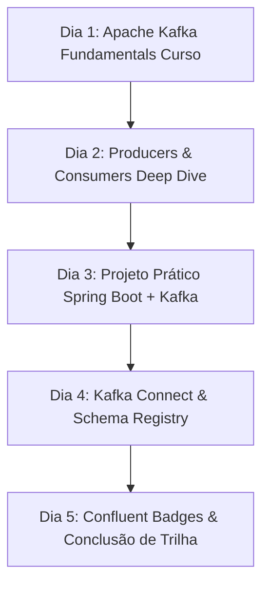

# Plano de Estudos Dedicado: Confluent Developer Badges & Apache Kafka Fundamentals

> **Objetivo**: Conquistar os badges e certificações de curso oficiais na **Confluent Developer Academy** (100% gratuitos) e criar uma base sólida prática de Apache Kafka com Spring Boot para o ecossistema Java.

---

## 📌 Informações Gerais da Capacitação

* **Instituição**: Confluent (Confluent Developer)
* **Plataforma**: [developer.confluent.io](https://developer.confluent.io/)
* **Custo**: **R$ 0,00 (Treinamentos, Cursos Interativos e Badges Gratuitos)**
* **Tempo estimado de preparação**: 10 a 15 horas de estudo hands-on
* **Formato**: Vídeos, laboratórios práticos e testes de verificação
* **Certificados**: Badges oficiais verificáveis no Credly/LinkedIn ao concluir as trilhas do Confluent Developer

---

## 🎯 Mapeamento do Conteúdo Programático

### Módulo 1: Arquitetura Core do Apache Kafka
* **Conceitos Chave**:
  * O que é Event Streaming Platform.
  * Estrutura do cluster: **Brokers**, **Controller**, **ZooKeeper vs. KRaft** (Kafka Raft Metadata Mode).
  * **Topics** (Tópicos) e **Partitions** (Partições).
  * **Log Append-only**, **Offsets** (Deslocamento) e retenção de mensagens.

---

### Módulo 2: Kafka Producers & Consumers
* **Producers (Produtores)**:
  * Como os produtores enviam mensagens com/sem chave (`key`).
  * Particionamento: Round-robin vs. Key-hash partitioning.
  * Configurações cruciais de confiabilidade: `acks=0`, `acks=1`, `acks=all` (`min.insync.replicas`).
* **Consumers (Consumidores)**:
  * **Consumer Groups** (Grupos de Consumidores) e balanceamento de partições.
  * Commit de offsets: Autocommit vs. Manual commit (`ackMode`).
  * Fenômeno de Rebalanceamento (*Rebalance*).

---

### Módulo 3: Integração Prática com Java & Spring Boot
* **Spring Kafka & Spring Cloud Stream**:
  * Configuração de `KafkaTemplate` e anotações `@KafkaListener`.
  * Serialização e Deserialização (String, JSON, Avro com Schema Registry).
  * Tratamento de Erros e Padrões de Resiliência:
    * **Dead Letter Topics (DLT)**.
    * Retries / Exponential Backoff.

---

### Módulo 4: Ecossistema Confluent & Ferramentas
* **Confluent Schema Registry**: Governança de esquemas Avro/Protobuf.
* **Kafka Connect**: Conectores de Origem (*Source*) e Destino (*Sink*) para integração com bancos de dados relacionais e NoSQL sem escrever código.
* **ksqlDB / Stream Processing**: Introdução ao processamento de streams em tempo real.

---

## 📅 Cronograma de Estudos Passo a Passo (Plano de 5 Dias)

### 🗓️ Dia 1: Cadastro e Curso Fundamentals
1. Criar conta no portal [developer.confluent.io](https://developer.confluent.io/).
2. Iniciar a trilha **Apache Kafka 101**.
3. Entender a arquitetura interna de Brokers, Tópicos e Partições.

### 🗓️ Dia 2: Produtores, Consumidores e Garantias de Entrega
1. Estudar as configurações de `acks`, retries e idempotência nos produtores.
2. Estudar o funcionamento de *Consumer Groups* e *offset management*.

### 🗓️ Dia 3: Mão na Massa com Spring Boot
1. Subir um cluster Kafka local via `docker-compose.yml`.
2. Criar uma aplicação Spring Boot com `@KafkaListener` e `KafkaTemplate`.
3. Testar o envio de mensagens com chaves e simular um cenário de Dead Letter Topic (DLT).

### 🗓️ Dia 4: Schema Registry e Kafka Connect
1. Fazer o curso curto de **Confluent Schema Registry** (conceito de Avro e evolução de schemas).
2. Entender o uso de Kafka Connect para espelhar dados de bancos relacionais (ex: PostgreSQL/MySQL) para tópicos Kafka.

### 🗓️ Dia 5: Emissão dos Badges Digitais
1. Finalizar os testes dos módulos da Confluent Developer Academy.
2. Emitir os **Badges Digitais de Conclusão** e vincular ao seu perfil do LinkedIn!
