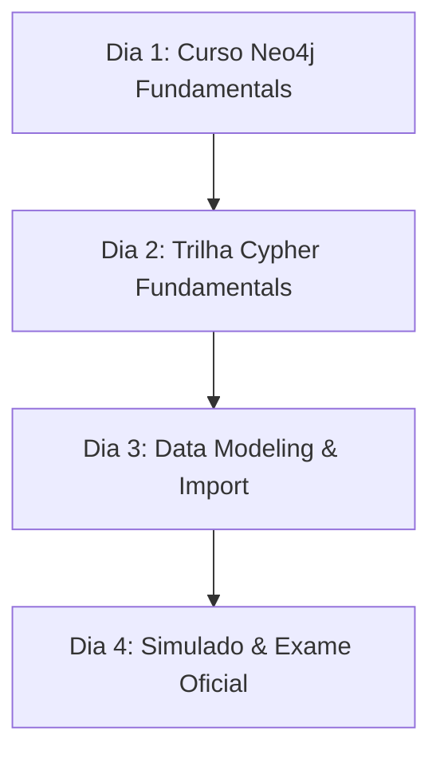

# Plano de Estudos Dedicado: Neo4j Certified Professional

> **Objetivo**: Conquistar a certificação oficial **Neo4j Certified Professional** (100% gratuita) e dominar bancos de dados orientados a grafos e a linguagem de consulta Cypher.

---

## 📌 Informações Gerais do Exame

* **Instituição**: Neo4j (GraphAcademy)
* **Plataforma**: [graphacademy.neo4j.com](https://graphacademy.neo4j.com/)
* **Custo**: **R$ 0,00 (Gratuito)**
* **Tempo estimado de preparação**: 8 a 12 horas de estudo
* **Formato**: 80 questões de múltipla escolha (online) em 60 minutos
* **Nota de aprovação**: 80% ou superior (pode refazer o exame caso não passe de primeira)
* **Certificado**: Certificado oficial PDF e badge digital verificável

---

## 🎯 Mapeamento do Conteúdo Programático

### Módulo 1: Conceitos de Bancos de Dados em Grafos
* **Conceitos Chave**:
  * Diferença entre **Relacional (RDBMS)** vs. **Grafos (Property Graph Model)**.
  * Elementos básicos: **Nós (Nodes)**, **Relacionamentos (Relationships)**, **Rótulos (Labels)** e **Propriedades (Properties)**.
  * Index-Free Adjacency (Adjacência sem índice) e por que consultas em grafos mantêm alta performance mesmo em grandes volumes de dados.

---

### Módulo 2: Linguagem de Consulta Cypher
* **Conceitos Chave**:
  * Cláusulas fundamentais: `MATCH`, `WHERE`, `RETURN`, `CREATE`, `MERGE`, `SET`, `DELETE`, `REMOVE`.
  * Padrões de sintaxe: `(node:Label)-[:RELATIONSHIP_TYPE]->(other:Label)`.
  * Cláusulas intermediárias: `WITH` (para encadear consultas), `UNWIND` (converter listas em linhas), `OPTIONAL MATCH`.
  * Funções de agregação: `count()`, `collect()`, `sum()`, `avg()`.

---

### Módulo 3: Modelagem de Dados em Grafos
* **Conceitos Chave**:
  * Como transformar um diagrama E-R ou relacional em um Modelo de Grafo.
  * Boas práticas: Rótulos específicos vs. Propriedades generadas.
  * Relacionamentos direcionados e como gerenciá-los.

---

### Módulo 4: Índices, Restrições e Performance
* **Conceitos Chave**:
  * Restrições de unicidade (`CREATE CONSTRAINT ... IS UNIQUE`).
  * Índices em propriedades (`CREATE INDEX ...`).
  * Uso do `EXPLAIN` e `PROFILE` para otimização de queries Cypher.

---

## 📅 Cronograma de Estudos Passo a Passo (Plano de 4 Dias)

### 🗓️ Dia 1: Cadastro e Cursos Básicos
1. Criar conta em [graphacademy.neo4j.com](https://graphacademy.neo4j.com/).
2. Concluir o curso **Neo4j Fundamentals**.
3. Entender a estrutura do *Property Graph Model*.

### 🗓️ Dia 2: Domínio da Linguagem Cypher
1. Concluir o curso **Cypher Fundamentals**.
2. Praticar queries no **Neo4j Sandbox** ou **Neo4j Desktop** (instância gratuita).

### 🗓️ Dia 3: Modelagem de Dados e Recursos Avançados
1. Concluir o curso **Graph Data Modeling for Neo4j**.
2. Revisar criação de Índices, Constraints e comandos `MERGE`.

### 🗓️ Dia 4: Reconciliação e Prova de Certificação
1. Fazer o simulado / revisar os quizes dos cursos da GraphAcademy.
2. Iniciar o exame **Neo4j Certified Professional Exam**.
3. Adicionar a certificação ao LinkedIn/Credly!
