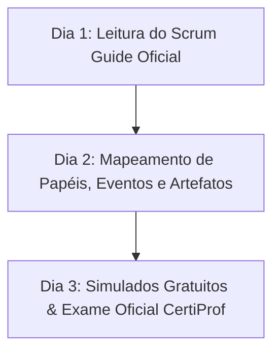

# Plano de Estudos Dedicado: CertiProf Scrum Foundation (SFPC)

> **Objetivo**: Conquistar a certificação oficial **Scrum Foundation Professional Certificate (SFPC)** da CertiProf (100% gratuita) e consolidar os conceitos fundamentais de metodologias ágeis e o Guia Scrum.

---

## 📌 Informações Gerais do Exame

* **Instituição**: CertiProf
* **Plataforma**: [certiprof.com](https://certiprof.com/)
* **Custo**: **R$ 0,00 (Gratuito)**
* **Tempo estimado de preparação**: 3 a 5 horas de estudo
* **Formato**: 40 questões de múltipla escolha (online) em 60 minutos
* **Nota de aprovação**: 80% (32 acertos de 40)
* **Certificado**: Certificado oficial e badge digital verificável

---

## 🎯 Mapeamento do Conteúdo Programático

### 1. O Manifesto Ágil
* **4 Valores Fundamentais**:
  1. Indivíduos e interações mais que processos e ferramentas.
  2. Software em funcionamento mais que documentação abrangente.
  3. Colaboração com o cliente mais que negociação de contratos.
  4. Responder a mudanças mais que seguir um plano.
* **12 Princípios do Manifesto Ágil**.

---

### 2. O Framework Scrum (Baseado no Scrum Guide Oficial)
* **Definição de Scrum**: Um framework leve que ajuda pessoas, equipes e organizações a gerar valor por meio de soluções adaptativas para problemas complexos.
* **Pilares do Scrum**: **Transparência**, **Inspeção** e **Adaptação**.
* **Valores do Scrum**: Compromisso, Foco, Abertura, Respeito e Coragem.

---

### 3. Papéis no Scrum (Scrum Team)
* **Developers (Desenvolvedores)**: Pessoas comprometidas em criar qualquer aspecto de um incremento útil a cada Sprint.
* **Product Owner (PO)**: Responsável por maximizar o valor do produto e gerenciar o *Product Backlog*.
* **Scrum Master (SM)**: Responsável por estabelecer o Scrum conforme definido no Guia e ajudar na remoção de impedimentos.

---

### 4. Eventos do Scrum (Rituais)
* **A Sprint**: O coração do Scrum (duração máxima de 1 mês).
* **Sprint Planning**: Planejamento do trabalho a ser realizado na Sprint.
* **Daily Scrum**: Reunião diária de 15 minutos para os Desenvolvedores inspecionarem o progresso rumo à Meta da Sprint.
* **Sprint Review**: Inspeção do incremento com partes interessadas ao final da Sprint.
* **Sprint Retrospective**: Oportunidade para o Scrum Team inspecionar a si mesmo e criar um plano de melhorias.

---

### 5. Artefatos do Scrum
* **Product Backlog** (Compromisso: *Product Goal* / Meta do Produto).
* **Sprint Backlog** (Compromisso: *Sprint Goal* / Meta da Sprint).
* **Incremento** (Compromisso: *Definition of Done* / Definição de Pronto - DoD).

---

## 📅 Cronograma de Estudos Passo a Passo (Plano de 3 Dias)

### 🗓️ Dia 1: Leitura Atenta do Guia Scrum
1. Baixar e ler o **Scrum Guide Oficial** (em português ou inglês) disponível gratuitamente em [scrumguides.org](https://scrumguides.org/).
2. Memorizar os 3 pilares e os 5 valores do Scrum.

### 🗓️ Dia 2: Rituais, Responsabilidades e DoD
1. Rever a diferença clara de papéis entre *Product Owner*, *Scrum Master* e *Developers*.
2. Entender o conceito da **Definition of Done (DoD)** e por que o incremento deve estar "pronto" e testado ao final da Sprint.

### 🗓️ Dia 3: Simulados e Prova de Certificação
1. Fazer simulados online gratuitos (ex: Simulados Scrum Open na Scrum.org / Simulados CertiProf).
2. Acessar a plataforma da CertiProf e realizar o exame **Scrum Foundation Professional Certificate (SFPC)**.
3. Baixar o certificado e publicar no LinkedIn!
