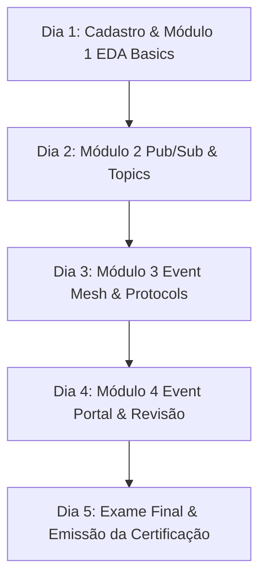

# Plano de Estudos Dedicado: Solace Certified EDA Practitioner

> **Objetivo**: Conquistar a certificação oficial **Solace Certified Event-Driven Architecture Practitioner** (100% gratuita) e dominar os conceitos fundamentais de Arquitetura Orientada a Eventos (EDA).

---

## 📌 Informações Gerais do Exame

* **Instituição**: Solace (Solace Academy)
* **Plataforma**: [academy.solace.com](https://academy.solace.com/)
* **Custo**: **R$ 0,00 (Gratuito)**
* **Tempo estimado de preparação**: 6 a 10 horas de estudo
* **Formato do curso**: Aulas em vídeo, leituras e quizes de fixação por módulo
* **Formato do exame**: Questões de múltipla escolha online na própria plataforma
* **Certificado**: Credencial digital com badge verificável para LinkedIn e Credly

---

## 🎯 Mapeamento do Conteúdo Programático

### Módulo 1: Fundamentos de Arquitetura Orientada a Eventos (EDA)
* **Conceitos Chave**:
  * Diferença entre **Request-Response (REST/RPC)** vs. **Event-Driven (EDA)**.
  * O que é um **Evento** (mudança de estado com timestamp e dados).
  * Componentes de EDA: **Producers**, **Consumers**, **Event Brokers** e **Event Mesh**.
  * Vantagens do desacoplamento: escalabilidade, resiliência, baixa latência e processamento assíncrono.
* **Perguntas Guia de Estudo**:
  * *Por que REST HTTP limita a escalabilidade de microsserviços encadeados?*
  * *O que diferencia um comando (Command) de um evento (Event)?*

---

### Módulo 2: Padrões de Mensageria & Pub/Sub
* **Conceitos Chave**:
  * Padrão **Publish-Subscribe (Pub/Sub)** vs. **Point-to-Point (Queues)**.
  * **Topics**: Hierarquia de tópicos, sintaxe e nomenclatura (ex: `empresa/pedidos/criado/v1`).
  * **Wildcards de Tópicos**:
    * Wildcard de nível único (`*`).
    * Wildcard multinível (`>`).
  * **Direct Messaging vs. Guaranteed Messaging**:
    * *Direct Messaging*: Alta performance, não persistente (At-Most-Once).
    * *Guaranteed Messaging*: Persistência em disco, sem perda de mensagens (At-Least-Once).
* **Perguntas Guia de Estudo**:
  * *Como funciona o roteamento de tópicos dinâmico em comparação com tópicos estáticos?*
  * *Em qual cenário usaríamos Direct Messaging em vez de Guaranteed Messaging?*

---

### Módulo 3: Plataforma Solace PubSub+ & Event Mesh
* **Conceitos Chave**:
  * **Solace PubSub+ Broker**: Software Broker, Appliance (Hardware) e Cloud Services.
  * **Event Mesh**: O que é, como conecta brokers distribuídos (multi-cloud e on-premise) e realiza o roteamento dinâmico de eventos sem intervenção manual.
  * **Multi-protocol Support**: Como o Solace PubSub+ traduz nativamente entre diferentes protocolos (AMQP, JMS, MQTT, REST, WebSockets, SMF) sem necessidade de gateways intermediários.
* **Perguntas Guia de Estudo**:
  * *Como o Event Mesh permite que um microserviço na AWS receba eventos de um servidor On-Premise?*

---

### Módulo 4: Governança de Eventos com o Solace Event Portal
* **Conceitos Chave**:
  * **Solace Event Portal**: Ferramenta de design, catalogação, descoberta e governança de eventos.
  * Padrão **AsyncAPI**: Documentação de APIs orientadas a eventos (análogo ao OpenAPI/Swagger para REST).
  * Ciclo de vida dos eventos e esquemas (Schemas/Avro/JSON Schema).

---

## 📅 Cronograma de Estudos Passo a Passo (Plano de 5 Dias)

### 🗓️ Dia 1: Abertura da Conta e Conceitos Fundamentais
1. Criar conta gratuita em [Solace Academy](https://academy.solace.com/).
2. Matricular-se na trilha **Solace Certified Event-Driven Architecture Practitioner**.
3. Assistir aos vídeos do **Módulo 1 (Fundamentals of EDA)**.
4. Anotar a diferença prática entre *Request/Response* vs *Event-Driven*.

### 🗓️ Dia 2: Padrões de Mensageria e Tópicos Solace
1. Estudar a sintaxe de **Hierarquia de Tópicos** e wildcards (`*` e `>`).
2. Resolver os exercícios práticos de filtragem de tópicos.
3. Estudar as diferenças entre **Direct vs Guaranteed Messaging**.

### 🗓️ Dia 3: Arquitetura de Event Mesh & Multi-Protocolo
1. Assistir às aulas sobre **Solace PubSub+ Broker** e **Event Mesh**.
2. Entender como o protocolo **REST** se conecta a **JMS/AMQP/MQTT** dentro do broker Solace.

### 🗓️ Dia 4: Event Portal, AsyncAPI e Simulado
1. Estudar o **Solace Event Portal** e o padrão **AsyncAPI**.
2. Refazer todos os quizes de final de módulo da Solace Academy.
3. Revisar as *Perguntas Guia de Estudo* deste documento.

### 🗓️ Dia 5: Exame Final e Certificação
1. Fazer o **Exame Final** na plataforma Solace Academy.
2. Fazer download do Certificado Digital PDF.
3. Adicionar o badge ao **LinkedIn** (Seção *Licenças e Certificações*) e atualizar o arquivo `README.md` do seu currículo.

---

## 📝 Conexão com seu Stack (Java / Spring Boot)

Para fixar o aprendizado com sua experiência prática como desenvolvedor Java:
* **Spring Boot + JMS/AMQP**: O Solace se integra diretamente com Spring Cloud Stream e Spring Boot via *Spring Cloud Stream Binder for Solace PubSub+*.
* **Kafka vs. Solace**:
  * *Kafka*: Baseado em log distribuído de eventos (Log-centric append).
  * *Solace*: Broker de mensageria nativo com roteamento dinâmico de tópicos no nível do broker (Broker-centric routing).

---

## 🚀 Próxima Ação Imediata
Acesse [Solace Academy](https://academy.solace.com/), faça seu cadastro e inicie o Módulo 1!
